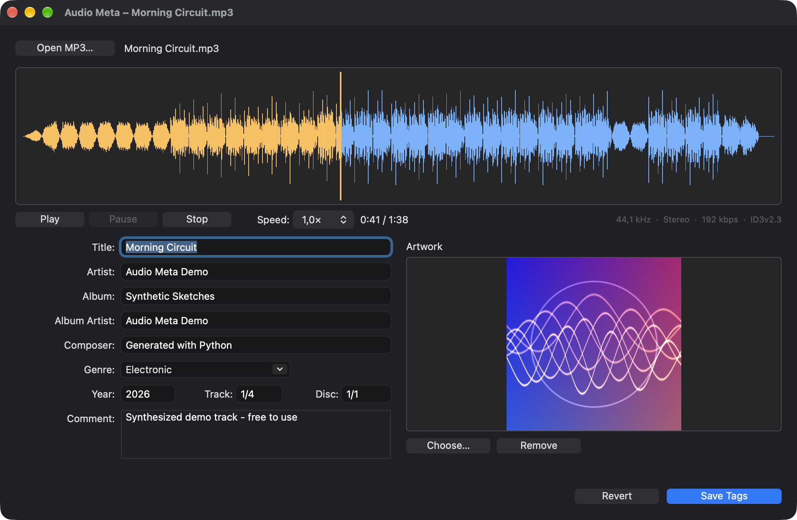

# Audio Meta

**Audio Meta** is a small desktop app, written in [Xojo](https://www.xojo.com), for viewing, playing and tagging MP3 files.
Open an MP3 and you see its waveform, can listen to it at different speeds, and can edit its ID3 tags,
including the album artwork, without leaving the app.

The screenshot shows *Morning Circuit*, a demo track synthesized from scratch for this README, with generated artwork.
No third-party music or artwork is shown.

## What it's for

Music collections tend to collect inconsistent or missing tags: a missing album artist, track numbers without
totals, no cover art, a wrong genre. Audio Meta is meant for checking and fixing such files one at a time:

- **See the file**: the waveform shows at a glance whether a file is complete, clipped, silent, or has a long gap at the end.
- **Hear the file**: play it, jump to any position by clicking the waveform, and slow down or speed up playback to check a passage.
- **Fix the tags**: edit the common fields and the cover, then save. Everything else stored in the tag is kept.

## Features

### Waveform
- Waveform overview of the whole song. A 5-minute MP3 loads in about half a second.
- Loading runs in the background with a progress bar, so the window never freezes.
- Hovering shows the time under the pointer; clicking or dragging moves the playback position.
- The part already played is drawn in a different color, with a playhead.

### Playback
- **Play**, **Pause** (continues where you stopped) and **Stop** (back to the beginning).
- Playback speed from **0.5×** to **2×**; the pitch stays the same.

### Tag editing (ID3)
- Title, Artist, Album, Album Artist, Composer, Genre, Year, Track, Disc and Comment.
- Album artwork: shows the front cover, lets you replace it with a JPEG or PNG, or remove it.
- Reads ID3v2.2, v2.3 and v2.4 tags, falling back to an ID3v1 tag for fields that are missing in ID3v2.
- **Non-destructive saving**: frames Audio Meta doesn't edit (lyrics, ReplayGain, chapters, other pictures, …) are written back unchanged.
  The tag version stays the same (v2.4 stays v2.4; everything else is written as v2.3), and an existing ID3v1 tag is updated too.
- When the new tag fits into the space of the old one, only the tag is rewritten in place; otherwise the file is
  rewritten with some padding so later edits are fast.
- **Revert** discards unsaved changes.

### App
- Open files with the **Open MP3…** button, **File ▸ Open…** (⌘O), or by dropping an MP3 onto the window.
- Save with **Save Tags** or **File ▸ Save Tags** (⌘S).
- Remembers the window size and position. If the saved position is no longer on any screen, the window opens centered.
- The artwork area grows with the window.
- Supports light and dark mode.
- Available in **English**, **German**, **French**, **Italian** and **Spanish**, following the system language (English for all other languages).

## Platform support

Audio Meta is developed and tested on **macOS**. The project is cross-platform Xojo code, but some features use macOS
system frameworks:

| Feature | macOS | Windows / Linux |
|---|---|---|
| Tag reading and writing | ✅ | ✅ (pure Xojo code) |
| Waveform | ✅ decoded with Core Audio | ⚠️ approximate loudness curve read from the MP3 frames |
| Playback | ✅ with pause, seeking and speed control (AVFoundation) | ⚠️ play/stop only, no seeking or speed control (Xojo `Sound`) |

Windows and Linux builds have not been tested.

## Building

1. Install [Xojo](https://www.xojo.com) (the project was created with Xojo 2026 Release 3).
2. Open `Audio Meta.xojo_project`.
3. Click **Run** to start it, or **Build** to create the app.

There are no plugins or external dependencies.

## How it works

| File | Purpose |
|---|---|
| `Window1.xojo_window` | Main window: layout, waveform drawing, playback controls, tag fields |
| `ID3Tag.xojo_code` | Reads and writes ID3v1 and ID3v2.2/2.3/2.4 tags, including artwork |
| `MP3Waveform.xojo_code` | Reads the MPEG frame headers (duration, bitrate, sample rate) and builds the waveform |
| `AudioPlayer.xojo_code` | Playback: `AVAudioPlayer` on macOS, Xojo's `Sound` class elsewhere |
| `Localized.xojo_code` | All user-visible text in five languages |
| `App.xojo_code`, `MainMenuBar.xojo_menu` | App setup (quit when the window closes) and menus |

Some implementation notes:

- **Fast waveform:** instead of decoding the whole file, `MP3Waveform` jumps to 1,200 evenly spaced positions
  (`ExtAudioFileSeek`) and decodes a short slice at each. The minimum and maximum of each slice are found with
  Accelerate's `vDSP_minv` / `vDSP_maxv`. Analysis runs on a preemptive `Thread`.
- **Safe saving:** when the tag doesn't fit in place, the file is written to a temporary file next to the original,
  which then replaces the original.
- **Settings** are stored in `~/Library/Application Support/Audio Meta/WindowSettings.json` (macOS) or the
  roaming AppData folder (Windows).

### Adding a language

All text lives in the `Localized` module as localized string constants. Add an entry for the new language code to
each constant in the Xojo IDE; menus, window controls and messages pick it up automatically.

## Known limitations

- MP3 only (no AAC/M4A, FLAC, Ogg, …).
- When a file has to be fully rewritten, Finder metadata such as the creation date and extended attributes is not kept.
- Compressed or encrypted ID3 frames are preserved but not shown.
- The app doesn't warn about unsaved tag changes when you open another file or close the window.
- The waveform is built from short slices of the audio, so very brief peaks between two slices may not show.

## License

Audio Meta is licensed under the [GNU General Public License v3.0](LICENSE).
